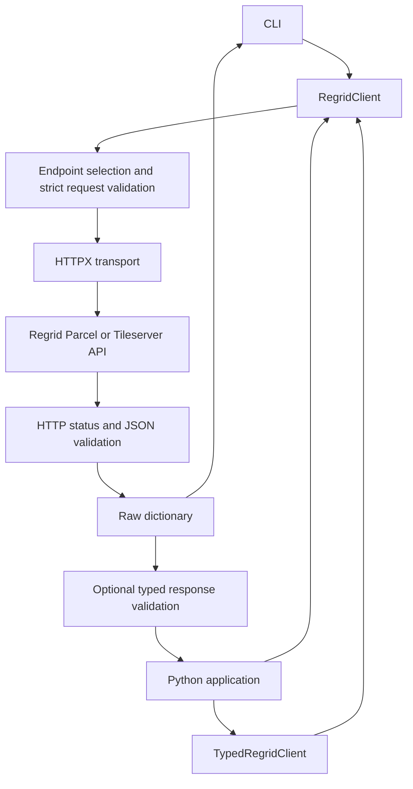

# Architecture

The SDK separates API transport, endpoint behavior, request validation, and optional response modeling. It is synchronous and uses HTTPX plus Pydantic v2. The CLI deliberately uses the dictionary client so introducing typed models does not change command output.

## Components

| Module | Responsibility |
| --- | --- |
| `client.py` | HTTP client lifecycle, token injection, HTTP errors, JSON decoding, search limits, and tiles |
| `endpoints.py` | US/Canada routes, supported options, query serialization, and GET/POST bodies |
| `requests.py` | Strict request models, cached endpoint-option models, and sanitized validation failures |
| `config.py` | Client settings, HTTPS base URLs, limits, tile coordinates, and token storage |
| `models.py` | Response envelopes, discriminated GeoJSON models, usage, metadata, and serialization |
| `typed.py` | `TypedRegridClient`, which validates raw responses into endpoint-specific models |
| `cli.py` | Argument parsing, JSON or `@file` input, command dispatch, and output formatting |
| `__init__.py`, `__main__.py` | Public imports and `python -m regrid` entry point |

## Request and Response Flow

`RegridClient` inherits endpoint helpers from `EndpointsMixin`. Helpers validate options against the selected endpoint and country, serialize GeoJSON and field filters, and call `_request`. The transport applies a default search limit, injects the token for authenticated requests, and decodes JSON. Binary tile responses bypass JSON decoding.

`TypedRegridClient` owns a `RegridClient` exposed as `.raw`; both share one transport and lifetime. Its methods delegate once, then validate the response. `.to_dict()` serializes an existing model without another API call. Closing the typed client also closes `.raw`.

## Validation and Compatibility

Request models use strict types and reject extra parameters. Model schemas for endpoint-specific options are cached. APNs remain strings; booleans cannot substitute for integer limits. Coordinate ranges, finite numbers, radius bounds, and tile indices are checked locally.

Response models validate known fields while allowing unknown fields. County attributes remain extensible dictionaries. Serialization uses aliases and excludes unset defaults, preserving omitted versus explicitly null fields. Count-only responses are selected explicitly rather than being interpreted as empty parcel responses.

Building, zoning, and typeahead properties remain dynamic dictionaries. Direct schema-map responses are preserved as extras; enveloped schema fields are typed. GeoJSON coordinate structures are modeled, but topology and polygon area are not calculated locally. These boundaries reflect inconsistencies in the supplied API specification.

## Credentials and Errors

Authentication uses the API's `token` query parameter. The client stores credentials as `SecretStr` and unwraps them only when constructing authenticated requests. Public schema requests omit authentication. Base URLs must use HTTPS and contain no credentials, query, or fragment; overrides must point to trusted destinations.

HTTP errors expose status codes without upstream bodies or request URLs. Request and typed-response validation failures discard the input-bearing Pydantic exception. Invalid JSON and non-finite upstream numbers are rejected. Temporary-token models mask credentials in normal representations; explicit `.to_dict()` exports reveal their temporary token.

HTTPX request logging can include tokens in URLs, so applications must redact logs. No automatic retries, redirects, pagination, result caching, or task-level budgets are implemented. Applications must manage broader usage limits and licensing obligations.

## Testing and Extension

Mocked tests exercise endpoint serialization, country differences, model validation, CLI output, and errors. `make check` enforces lint, formatting, typing, and 90% combined line/branch coverage. Separate `make e2e` tests use a local HTTPS server, temporary trusted certificates, and subprocess CLI calls; they require socket access and never contact Regrid.

For a new endpoint, add its route and exact options, extend request validation, provide an appropriate typed response and facade method, then expose the CLI command. Add mocked request/response tests and update the README and changelog. Preserve raw access for upstream responses that are not yet modeled.
